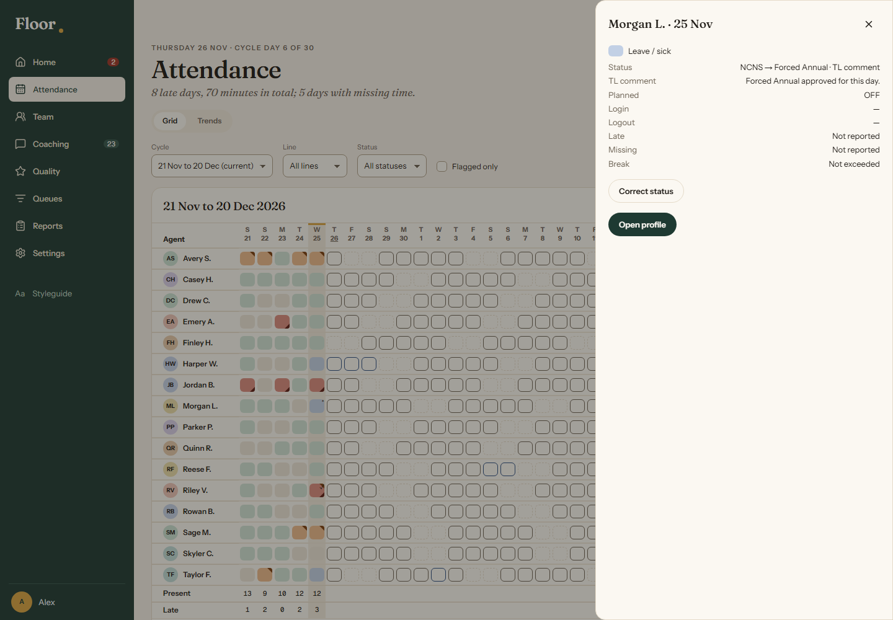
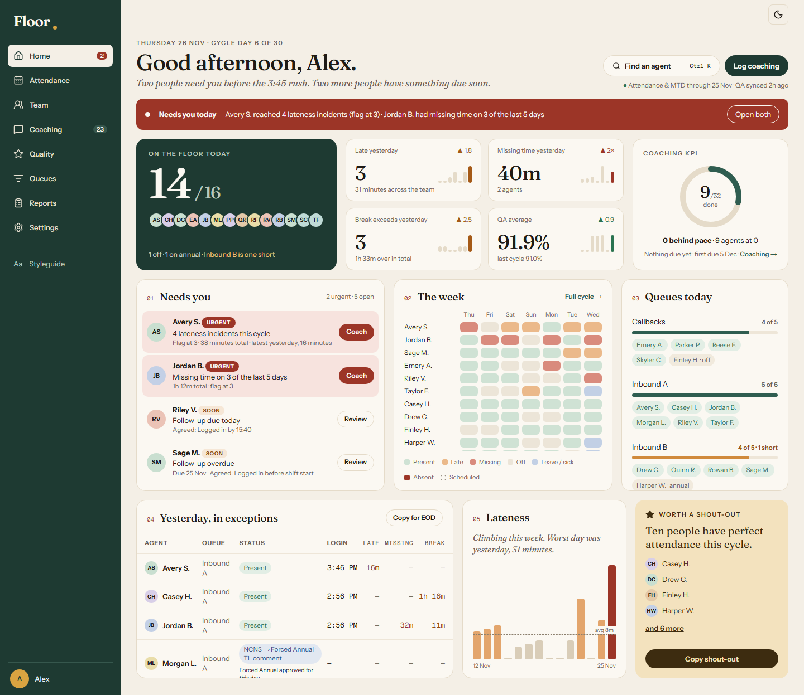
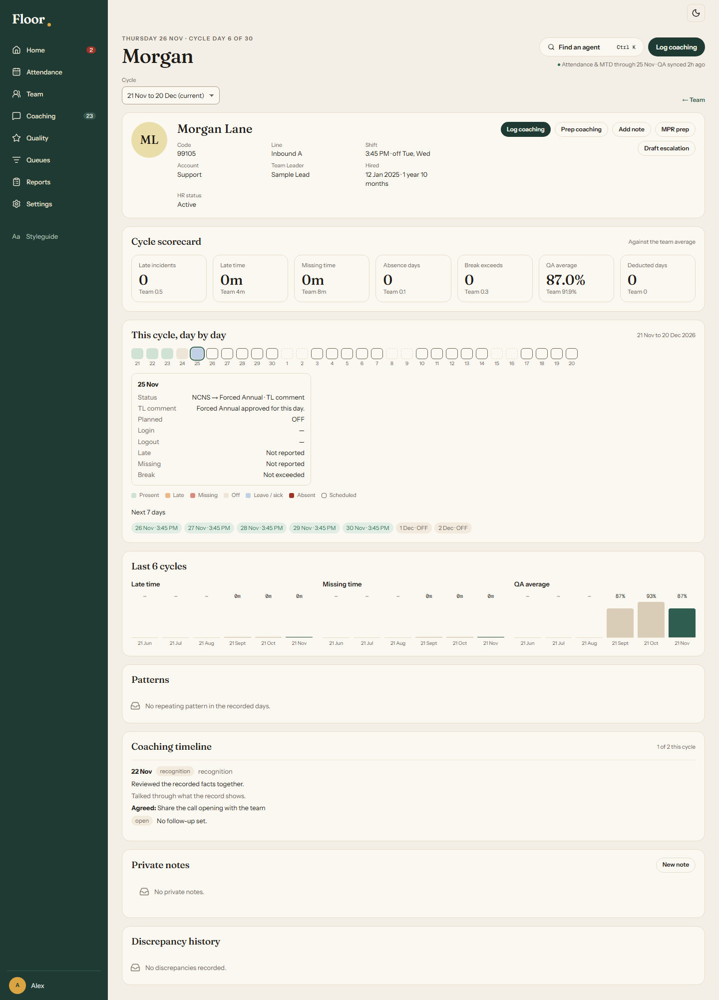

# Attendance corrections review

Owner-approved scope, 27 November 2026. Branch: `feature/attendance-corrections`, based on main at `e5d54f7`. Follow-up A is on PR #29; the owner authorized merging after green CI, after #28 and the optional-MTD/formula-error PR.

## Behavior

- Only `TL Comment` on the Attendance paste is allowed. Ops Comment, WFM Comment and other private columns remain refused.
- Matching ignores case and consumes longer overlapping labels first: `Forced Annual` does not also match `Annual`. Ignore any matched label mapping to WFM's own status, then count remaining distinct labels: one corrects; zero explains; two or more explain with `names more than one status, not corrected` in the drawer and Corrections list. `WFM marked NCNS, was on Forced Annual` corrects to Forced Annual; `NCNS confirmed` explains without changing status. No inference or negation parsing is performed.
- WFM source rows remain intact. Every corrected day carries the used status and provenance, for example `NCNS → Forced Annual · TL comment`. Grid, Home, profile, rules, counts, trends, shout-out, reports and coaching prep use the corrected status. Full-day nonworking corrections remove working-time incidents; MTD totals apply covered daily deltas so unpasted days still count.
- A note without a status leaves attendance counts unchanged. Its flags and discrepancies show Explained with the note, and explained facts no longer contribute to Needs you. Removing the comment restores normal treatment on the next successful sync.
- Matching WFM statuses in sheet comments now explain without an override. App corrections whose label matches WFM still show `WFM updated`. The next sync removes sheet corrections whose comment was cleared. Days outside the paste's covered agent/date pairs remain untouched.
- Attendance day drawer → Correct status saves a selected known status and a required note locally. App corrections survive sync and take precedence over sheet comments. Undo returns to the sheet's current correction or original WFM status.
- Settings → Corrections lists every corrected, explained or WFM-confirmed day across cycles, with agent, date, WFM/used status and sheet/app source.

## Privacy and checks

Comment/note text stays in local SQLite. It is never logged or included in reports, grid CSV, discrepancy exports or JSON backups. There is no automatic comment-copy action; the owner may select and copy text. Synthetic text only is used in tests and screenshots.

The local tables are additive: `attendance_sheet_comments` and `attendance_corrections`. Sync never writes the latter. JSON backup/restore deliberately does not transfer either table under the local-only rule.

Tests cover longest whole-label matching, ambiguous/no-label comments, WFM preservation, effective facts/counts/MTD deltas, flags, shout-out, all read views, export/log privacy, sync removal/WFM confirmation, app precedence, validation and Undo. The browser check exercises the real drawer, Settings list, CSV and responsive accessibility checks.

## Validation

| Check                                                   | Result                                |
| ------------------------------------------------------- | ------------------------------------- |
| `npm run lint`                                          | Passed                                |
| `npm run typecheck`                                     | Passed                                |
| `npm test -- --maxWorkers=1`                            | 249 passed, 1 existing skip           |
| `npm run build:smoke` (through Playwright startup)      | Passed; installed release untouched   |
| `npm run smoke -- --workers=1`                          | 26 passed                             |
| Final corrections, reports and Settings browser recheck | 3 passed on the final compiled source |

Parallel runs exceeded existing time/latency limits on this host. Serial runs kept every original assertion and timeout. The corrections browser case uses its own synthetic database, so it cannot reset another screen test's data.

## Synthetic review screenshots

Corrected grid day and its drawer:

Home: used status, original WFM status and local note:

Agent profile: corrected calendar day, WFM provenance and local note:

Phone views: [Home](design/corrections-home-390.png), [profile](design/corrections-profile-390.png).
